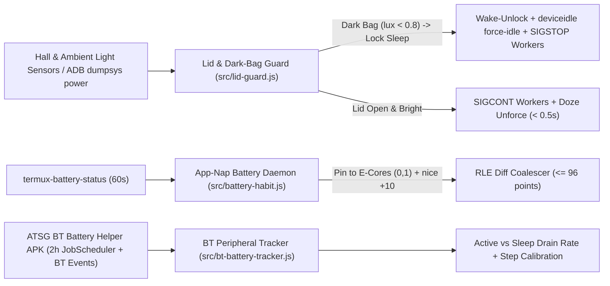

# Android Tablet Sleep Guard (`tablet-guard`)

[](https://github.com/classic180393-vn/android-tablet-sleep-guard/actions/workflows/ci.yml)
[](LICENSE)
[](package.json)
[](#quickstart)
[](package.json)

**macOS-style App-Nap, E-Core CPU Pinning, Magnetic Lid / Dark-Bag Deep-Freeze Guard, RLE-Diff Battery Telemetry & Bluetooth Keyboard Battery Tracker for Android Tablets running Termux.**

> 🌐 **Languages:** [English](#why-android-tablet-sleep-guard) · [Tiếng Việt (Bản hướng dẫn chi tiết)](README.vi.md)

---

## Why Android Tablet Sleep Guard?

When using an Android tablet (Galaxy Tab, Xiaomi Pad, Lenovo Tab, OnePlus Pad, etc.) with Termux and a magnetic Bluetooth keyboard cover as a portable Linux workstation:

1. **False Wakeups Inside Backpacks:** Magnetic folio covers slightly shift in bags, firing a Hall-effect `OPEN` event even when the tablet is inside a pitch-black bag.
2. **Termux Wake-Lock Leaks:** Background terminal sessions keep `PARTIAL_WAKE_LOCK` held after unplugging, burning **10–25% battery overnight**.
3. **OEM Background Wakeups:** Heavy OEM bloatware services (e.g. ZUI/ZUXOS AI/push/store daemons) silently spin up on AC unplug.
4. **Disk & Poll Bloat:** Naive 60s battery loggers write hundreds of redundant KB/day; Android rarely logs detachable Bluetooth keyboard battery curves over time.

**Typical Results on Android 14–16 Tablets + Termux:**
- **Overnight Deep Sleep (~8h):** `~0.2–0.3%/hour` (vs. `1.5–3%/hour` when Wake-Locks stay held)
- **Dark-Bag Transit (~1h):** `< 1%` drain (blocks accidental `hallOpen` triggers below `0.8 lux`)
- **RLE Diff Storage Footprint:** **`< 30 KB`** total JSON (`96` coalesced points max, `25%+` disk writes skipped)
- **External npm Dependencies:** **`0`** (Pure Node.js built-ins + standard Termux/ADB shell)

---

## Architecture



---

## Features

- **Magnetic Lid & Dark-Bag Guard (`src/lid-guard.js`):**
  - Dual detection via **ADB (`dumpsys power`)** or **ADB-free fallback (`termux-sensor` Hall Effect + Ambient Light)**.
  - **Dark-Bag Lux Lock:** Suppresses accidental magnetic-keyboard shifts when `ambient lux < darkLuxThreshold` (`0.8 lux`).
  - **Clean Freeze / Instant Wake:** Verified `termux-wake-unlock`, optional native worker `SIGSTOP`/`SIGCONT` (safely skipping `proot` children to avoid `ptrace` stalls), Android `dumpsys deviceidle force-idle`, and safe OEM UID-isolated soft-sleep.
- **macOS App-Nap Inspired Telemetry (`src/battery-habit.js`):**
  - Pins background helpers cleanly to **Efficiency Cores (`taskset -pc 0,1`)** with `renice +10`.
  - **RLE Diff Sample Coalescing:** Merges consecutive steady intervals (delta current `< 350 mA`, temp `< 0.8°C`, CPU `< 25%`, identical `%` & charge state), capping local storage at `96` points and `14` days.
- **Bluetooth Peripheral Battery Tracker + Android Helper APK (`src/bt-battery-tracker.js`, `android/bt-battery-helper/`):**
  - Pure Java zero-dependency Android APK (`com.atsg.btbattery`) using `BluetoothDevice.getBatteryLevel()` + BLE GATT Battery Service (`0x180F` / `0x2A19`), scheduled every `2 hours` via `JobScheduler` plus `BATTERY_LEVEL_CHANGED` / `ACL_CONNECTED` triggers.
  - Learns real **firmware reporting granularity** (e.g., `1%` vs `5%` vs `10%` steps) and separates **active typing drain** from **tablet-asleep standby drain**.

---

## Quickstart

### 1. Termux Prerequisites
```bash
pkg update && pkg install -y nodejs git
# Recommended: install Termux:API app + CLI package for sensors & battery
pkg install -y termux-api
```

### 2. Clone & Install
```bash
git clone https://github.com/classic180393-vn/android-tablet-sleep-guard.git
cd android-tablet-sleep-guard
bash install.sh
```

### 3. Common Commands
```bash
tablet-guard status              # Check daemons, battery, drain rate & RLE stats
tablet-guard daemon start        # Start Lid Guard + Battery Habit background daemons
tablet-guard eco                 # Pin helpers to E-cores (0,1), nice +10 & release wake-lock
tablet-guard sleep --dry-run     # Preview Deep-Freeze actions safely
tablet-guard battery             # Print tablet discharge analytics (%/h, mA, W, est hours)
tablet-guard bt-sync             # Pull Bluetooth keyboard/mouse/stylus battery & record diff
tablet-guard bt-report           # View calibrated keyboard battery drain rate & history
```

### 4. Optional: Build Bluetooth Battery Helper APK
If you have `aapt2`, `d8`, `apksigner`, `javac`, and an Android platform SDK (`android.jar`):
```bash
cd android/bt-battery-helper
bash build.sh
# Install via ADB:
adb install -r -g dist/atsg_btbattery.apk
adb shell "appops set com.atsg.btbattery MANAGE_EXTERNAL_STORAGE allow"
```

---

## Configuration

Config defaults live in `~/.config/android-tablet-sleep-guard/config.json` (generated by `tablet-guard init` from [`examples/config.example.json`](examples/config.example.json)).

Key options:
- `hallSensorPattern` / `lightSensorPattern`: Regex matching your tablet's `termux-sensor -l` names.
- `darkLuxThreshold`: Minimum ambient light (`0.8 lux` default) required to allow a lid wakeup when unplugged.
- `ecoCpuCores`: CPU core mask for background helpers (e.g. `"0,1"` for Snapdragon/Dimensity little E-cores).
- `oemSoftSleepPreset`: Set `"lenovo-zui"` or provide custom `oemStoppablePackages` (isolated-UID bloatware only — **never** include `android.uid.system` packages).

---

## Tóm tắt Tiếng Việt (Cho cộng đồng Android/Termux Việt Nam)

Xem hướng dẫn đầy đủ bằng Tiếng Việt tại [**README.vi.md**](README.vi.md) và chi tiết thiết kế tại [**docs/ARCHITECTURE.md**](docs/ARCHITECTURE.md).

**Tính năng chính:**
1. **Chống tụt pin khi bỏ balo (Lid + Cảm biến ánh sáng Lux):** Tự động thả `Wake-Lock`, đóng băng nhẹ app nền & kích hoạt Android Deep Doze; đặc biệt **khóa thức giả** nếu nam châm bàn phím xê dịch trong túi tối (`< 0.8 lux`).
2. **Đo pin thông minh theo mô hình Diff RLE & ghim nhân E-Core (học triết lý App-Nap của macOS):** Tự gộp các phút ổn định thành `1` mốc diff, giữ tệp dữ liệu chỉ vài chục KB, không hại bộ nhớ flash.
3. **Đo & hiệu chuẩn pin bàn phím Bluetooth rời:** Có sẵn mã nguồn APK Java thuần gọn nhẹ (`~25 KB`), quét 2h/lần & bắt sự kiện Bluetooth, tự tính tốc độ hao thực `%/ngày` và tách thời gian gõ vs ngủ.

---

## Development & Tests

```bash
npm run lint
npm test
```

## License

MIT © [classic180393-vn](LICENSE)
